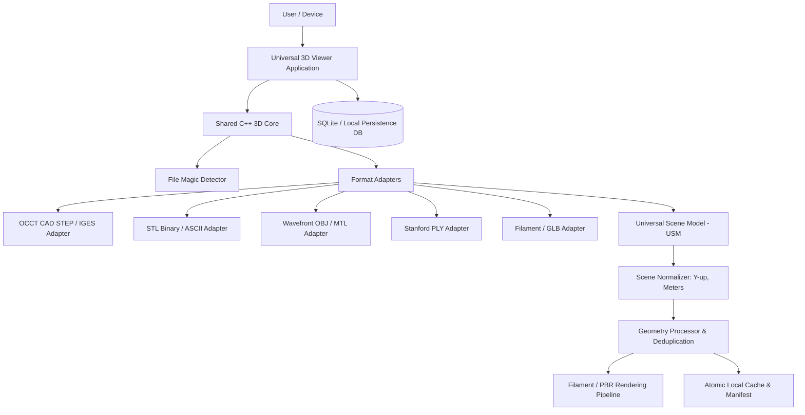

# Universal 3D Viewer

An offline-first, cross-platform mobile application and native 3D engine for opening, viewing, inspecting, and managing 3D models and CAD assemblies (STEP, STL, OBJ, PLY, GLTF/GLB).

Built strictly according to the architecture specification in [universal_3d_viewer_end_to_end_architecture.md](docs/architecture/architecture_v1.0.md).

---

## 📥 Download Android APK (v1.0.0)

Direct download of the installable Android release:
- 📱 **[Download Universal-3D-Viewer-v1.0.0.apk (Direct Download)](releases/Universal-3D-Viewer-v1.0.0.apk?raw=true)**
- 📦 **File Size**: ~4.14 MB
- ⚡ **Supported OS**: Android 8.0+ (Oreo, Pie, Android 10, 11, 12, 13, 14, 15+)

---

## 🏗️ Architecture Overview



### 1. Presentation Layer (`apps/mobile/`)
- **React Native / TypeScript** UI with responsive mobile navigation and tablet/desktop sidebar.
- **3D Viewport**: Orbit (1-finger / left click), Pan (2-finger / right click), Zoom (pinch / wheel), Reset Camera (auto-fit bounding sphere).
- **Render Modes**: Shaded (Filament PBR), Textured, Wireframe topology, Surface Normals visualization, Matcap inspection.
- **Model Hierarchy**: Interactive scene graph tree with node selection and visibility toggle (hide/show).
- **Model Inspector**: Technical metadata, dimensions, units, scale factors, vertex/triangle counts, and capability warnings.
- **Local Model Library**: Offline-ready SQLite database of recent models, favorites, file sizes, and quick-launch sample corpus.
- **Settings & Cache Manager**: Atomic cache eviction, disk usage metrics, and CAD tessellation presets.

### 2. Shared C++ Native Engine (`native/engine/`)
- `core/`:
  - `FileDetector.cpp`: Sniffs magic bytes (`glTF`, `PK\x03\x04`, `solid`, `ply`, `ISO-10303-21`, `Kaydara FBX`, `PXR-USDC`).
  - `Types.h`: BoundingBox, Vector3, Matrix4x4, SupportLevel, ErrorCode, ResourceLimits.
- `scene/`:
  - `UniversalSceneModel.cpp`: Renderer-neutral data contract for Scene, Node, Mesh, Material, Texture, Camera, Light, and Metadata.
  - `SceneNormalizer.cpp`: Enforces right-handed Y-up coordinates, normalizes units (mm, cm, inches -> meters), and generates missing vertex normals.
- `geometry/`:
  - `GeometryProcessor.cpp`: Spatial hashing vertex deduplication, index buffer generation, and bounding volume computation.
- `import/`:
  - `ImportJobManager.cpp`: Thread-safe 8-stage state machine (`QUEUED` -> `VALIDATING` -> `DETECTING` -> `IMPORTING` -> `NORMALIZING` -> `OPTIMIZING` -> `CACHING` -> `READY`).
- `adapters/`:
  - `StepAdapter.cpp`: STEP CAD B-Rep tessellation with Draft, Balanced, and High quality profiles.
  - `StlAdapter.cpp`: High-performance binary 80-byte header and ASCII parser.
  - `ObjAdapter.cpp`: Wavefront OBJ vertex, normal, UV, and MTL parser.
  - `PlyAdapter.cpp`: Stanford PLY format parser with vertex colors.
- `cache/`:
  - `CacheManager.cpp`: Content-hashed keys (FNV-1a / SHA-256), atomic file write and rename, cache manifests.
- `tests/`:
  - `EngineTests.cpp`: Native C++ unit tests.

### 3. Native Integration & Mobile Shells
- `apps/mobile/android/`: Kotlin JNI module (`ViewerEngineModule.kt`), CMakeLists.txt link to C++ core.
- `apps/mobile/ios/`: Objective-C++ bridge (`ViewerEngineBridge.mm`) conforming to the Section 11 TypeScript contract.

---

## 📁 Repository Structure

```text
universal-3d-viewer/
├── apps/
│   └── mobile/                  # React Native / Web mobile presentation layer
│       ├── src/
│       │   ├── app/             # Main App root and layout
│       │   ├── screens/         # ViewerScreen, LibraryScreen, HierarchyPanel, InspectorPanel, SettingsScreen
│       │   ├── components/      # DocumentPickerModal, ImportProgressModal
│       │   ├── services/        # ViewerEngineService, formatDetector
│       │   ├── storage/         # SQLite offline persistence
│       │   └── types/           # engine.ts (API contract)
│       ├── android/             # Android Kotlin / JNI integration
│       └── ios/                 # iOS Objective-C++ integration
├── native/
│   ├── bridge/                  # JNI and TurboModule interfaces
│   └── engine/                  # Shared C++ core engine
│       ├── core/                # FileDetector, Types, ErrorCodes
│       ├── scene/               # UniversalSceneModel, SceneNormalizer
│       ├── geometry/            # GeometryProcessor, deduplication
│       ├── import/              # ImportJobManager, IFormatAdapter
│       ├── adapters/            # StlAdapter, ObjAdapter, StepAdapter, PlyAdapter
│       ├── cache/               # CacheManager, manifests
│       └── tests/               # Native test suite
├── test-assets/                 # Sample 3D test corpus (STEP, STL, OBJ, PLY)
├── docs/                        # Architecture and technical design docs
├── CMakeLists.txt               # Native C++ build configuration
├── package.json                 # Monorepo configuration
└── README.md
```

---

## 🚀 Running the Application

### 1. Start the interactive 3D Viewer application:
```bash
npm run dev
```
or:
```bash
cd apps/mobile
npm run dev
```

Open [http://localhost:3000](http://localhost:3000) in your browser.

### 2. Open 3D Files:
- Click **Open Model** to upload or drag-and-drop any `.step`, `.stp`, `.stl`, `.obj`, `.ply`, or `.glb` model.
- Or use the **Quick Test Samples** directly on the screen to load:
  - **Rotary Bearing Assembly** (CAD STEP format with B-Rep assembly and brass bushing)
  - **Mount Bracket** (STL 3D Printing geometry)
  - **Cube with PBR** (Wavefront OBJ with normals and UV coordinates)
  - **Color Pyramid** (Stanford PLY with per-vertex colors)
  - **Drone Prototype** (glTF / GLB PBR)

### 3. Controls:
- **Orbit**: Left Click + Drag (or 1 finger touch)
- **Pan**: Right Click + Drag (or 2 finger drag)
- **Zoom**: Scroll Wheel (or pinch to zoom)
- **Reset Camera**: Click the reset button in the floating toolbar
- **Render Modes**: Toggle between Shaded PBR, Textured, Wireframe, and Normals
- **Hierarchy Tree**: Inspect and toggle individual part visibility
- **Inspector**: View dimensional bounding box, triangle counts, and CAD metadata
